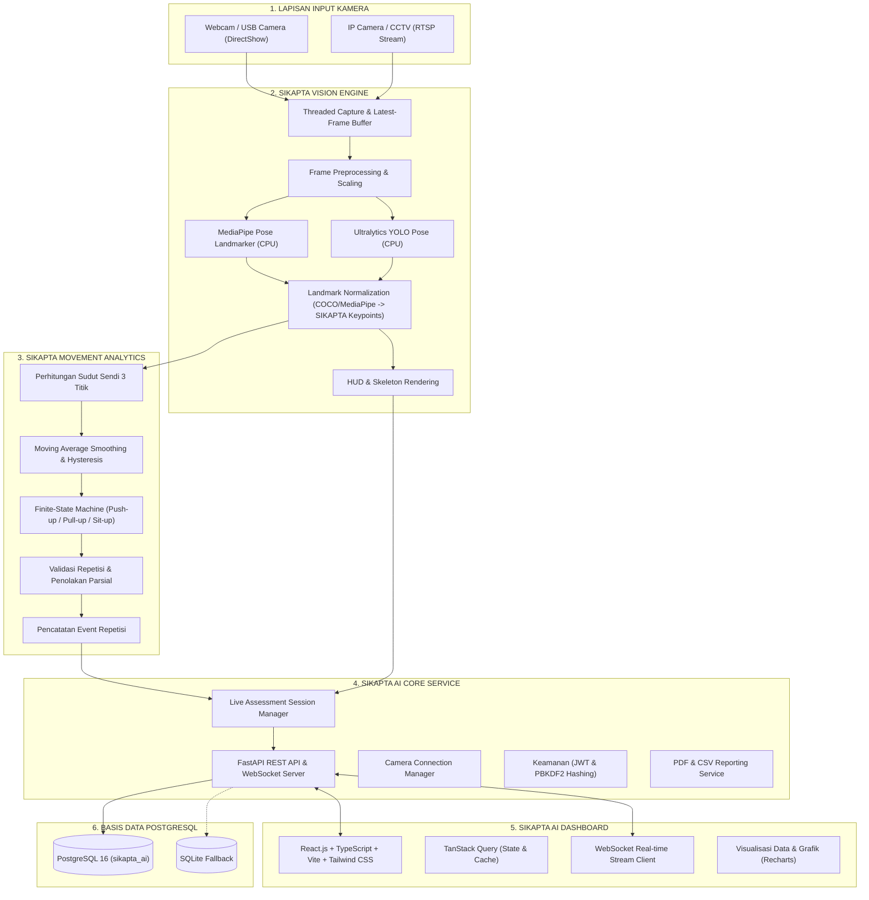

# SIKAPTA AI - Arsitektur Sistem

## 1. Ikhtisar Arsitektur

**SIKAPTA AI** (Sistem Inteligensi Kesamaptaan Jasmani Terpadu dan Adaptif) dirancang dengan arsitektur modular berlapis (*layered modular architecture*) untuk mendukung evaluasi kesamaptaan jasmani secara real-time pada perangkat CPU Windows tanpa ketergantungan pada GPU diskrit.

---

## 2. Rincian Modul Utama

### 2.1 SIKAPTA Vision Engine
Bertanggung jawab mengambil frame kamera dengan buffer non-blocking (*latest-frame buffer*), menjalankan model AI, dan menormalisasi 17 landmark standar tubuh manusia.
- **MediaPipe Pose Adapter**: Menghasilkan landmark dengan estimasi CPU yang sangat ringan.
- **YOLO Pose Adapter**: Menggunakan `yolov8n-pose.pt` untuk deteksi robust dari sudut pandang luas.
- **Normalizer**: Mengonversi output dari kedua format ke standar `LandmarkPoint(name, x, y, z, confidence, is_valid)`.

### 2.2 SIKAPTA Movement Analytics
Modul matematika dan state machine independen dari model AI:
- **Geometry**: Menghitung sudut interior antar 3 sendi tubuh.
- **Smoothing & Hysteresis**: Mencegah flip-flopping pada batas threshold sudut.
- **Push-up Analyzer**: Mengevaluasi sudut siku (<= 90° turun, >= 160° naik) dan kelurusan badan.
- **Pull-up Analyzer**: Mengevaluasi tarikan dagu melewati palang dan posisi lengan lurus saat gantung.
- **Sit-up Analyzer**: Mengevaluasi sudut torso-paha saat posisi rebah dan saat naik.

### 2.3 SIKAPTA AI Core Service
- Dibangun di atas **FastAPI** dengan arsitektur async.
- Protokol WebSocket menyalurkan metadata real-time dan frame beranotasi 30 FPS.
- Dilengkapi mekanisme fallback transparan ke SQLite jika server PostgreSQL offline.

### 2.4 SIKAPTA AI Dashboard
- Antarmuka berbasis **React 19 + TypeScript + Tailwind CSS**.
- Menggunakan skema warna institusional: Navy blue, emas, putih, hijau zamrud, dan merah peringatan.
- Terkoneksi ke REST API dan WebSocket untuk pemantauan live.

