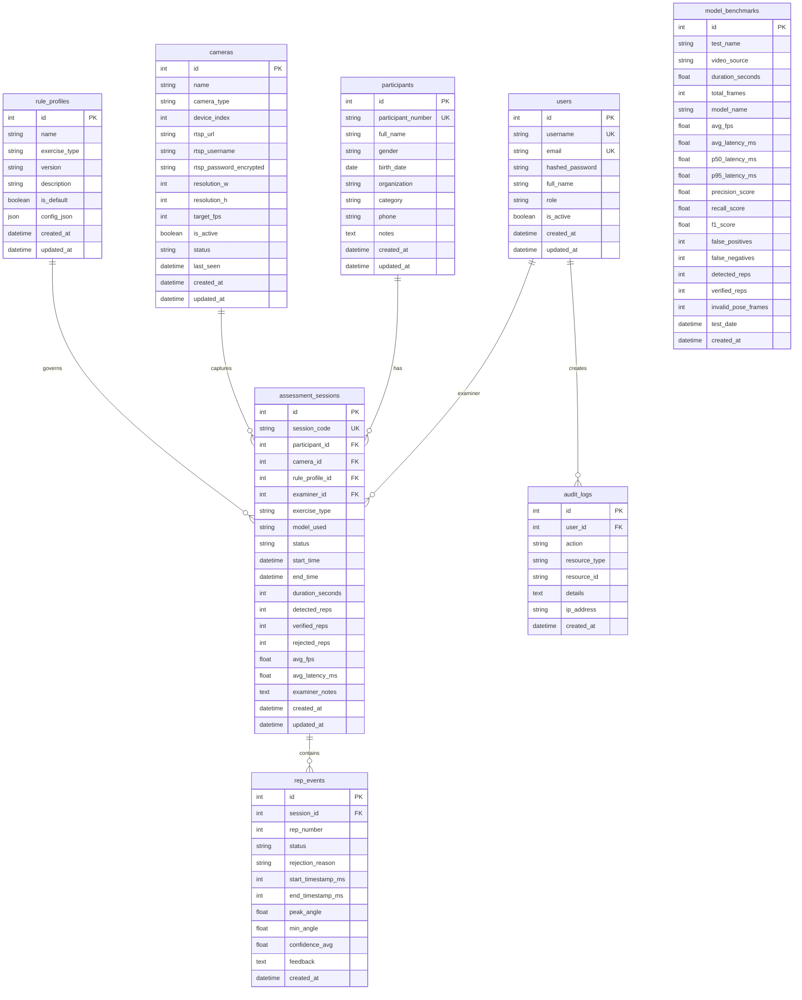

# SIKAPTA AI - Dokumentasi Basis Data PostgreSQL

Database Name: `sikapta_ai`  
ORM: SQLAlchemy 2.x  
Migration Tool: Alembic  

---

## 1. Skema Relasi Antar Tabel

---

## 2. Fitur Keamanan dan Integritas Basis Data
1. **Foreign Key Constraints dengan Cascade / Set Null**: Menghindari orphan data pada sesi pengujian saat kamera atau penguji dihapus.
2. **Indexing**: Diterapkan pada `participant_number`, `session_code`, `session_id`, `created_at` untuk mempercepat kueri analitik dan pencarian.
3. **Penyimpanan Non-Destruktif**: Tidak menyimpan file video mentah secara permanen secara default untuk menjaga privasi peserta dan menghemat penyimpanan disk.

