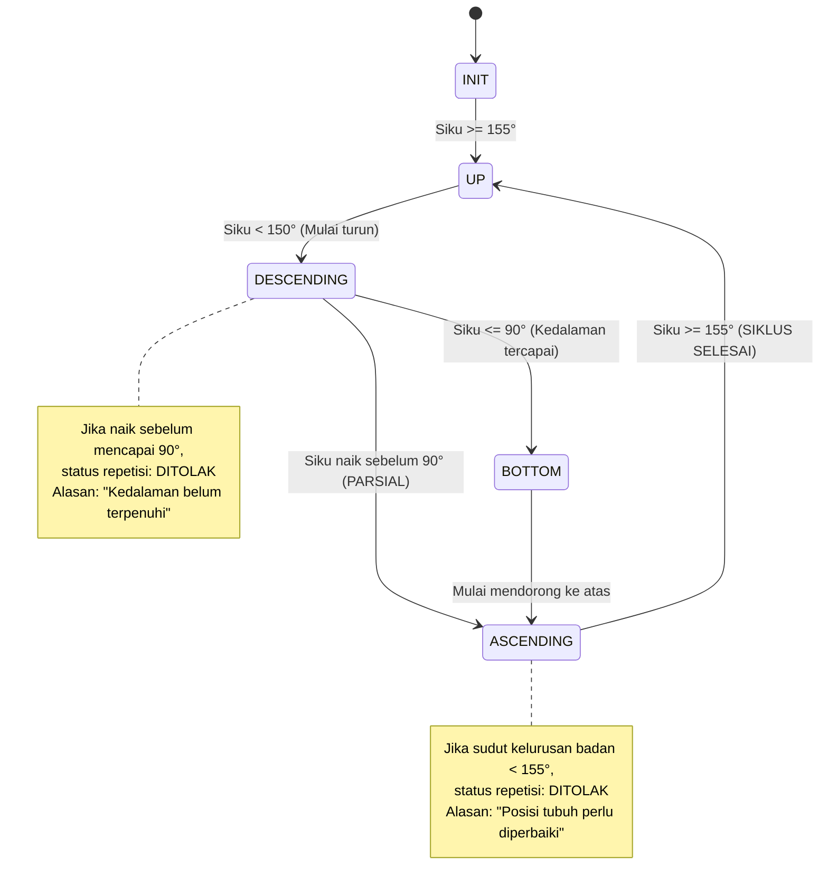

# SIKAPTA Movement Analytics - Aturan Validasi Gerakan

Modul **SIKAPTA Movement Analytics** merupakan mesin evaluasi biomekanika tubuh independen yang menggunakan Finite-State Machine (FSM), hysteresis, filter smoothing, dan confidence threshold.

---

## 1. Rumus Geometri Sudut Sendi (3-Point Angle)

Untuk setiap 3 landmark sendi $A, B, C$ dengan $B$ sebagai titik engsel (vertex):

$$\vec{BA} = (A_x - B_x, A_y - B_y), \quad \vec{BC} = (C_x - B_x, C_y - B_y)$$

$$\cos \theta = \frac{\vec{BA} \cdot \vec{BC}}{|\vec{BA}| \, |\vec{BC}|}$$

$$\theta = \arccos(\text{clamp}(\cos \theta, -1.0, 1.0)) \times \frac{180}{\pi}$$

---

## 2. Aturan Evaluasi Push-up

### Landmark Kunci
- Bahu (`shoulder`), Siku (`elbow`), Pergelangan Tangan (`wrist`), Pinggul (`hip`), Pergelangan Kaki (`ankle`).

### Parameter Aturan Default
- `down_elbow_angle_threshold`: $90.0^\circ$ (Kedalaman siku turun)
- `up_elbow_angle_threshold`: $160.0^\circ$ (Lengan lurus di atas)
- `body_alignment_angle_threshold`: $155.0^\circ$ (Kelurusan bahu - pinggul - kaki)
- `hysteresis_deg`: $5.0^\circ$
- `cooldown_frames`: $10$ frame

### Diagram FSM Push-up

---

## 3. Aturan Evaluasi Pull-up

### Landmark Kunci
- Bahu (`shoulder`), Siku (`elbow`), Pergelangan Tangan (`wrist`), Hidung/Kepala (`nose`).

### Parameter Aturan Default
- `bottom_elbow_angle_threshold`: $155.0^\circ$ (Posisi gantung lengan lurus)
- `top_elbow_angle_threshold`: $70.0^\circ$ (Puncak tarikan)
- `chin_over_bar_required`: `true` (Verifikasi dagu melewati garis pergelangan tangan/palang)
- `hysteresis_deg`: $5.0^\circ$

### Verifikasi Dagu terhadap Palang
Sudut siku saja tidak cukup untuk menyatakan repetisi sah. Posisi vertikal hidung/dagu ($y_{\text{nose}}$) harus lebih tinggi (nilai koordinat $y$ lebih kecil) dibanding rata-rata pergelangan tangan ($y_{\text{wrist}}$).

---

## 4. Aturan Evaluasi Sit-up

### Landmark Kunci
- Bahu (`shoulder`), Pinggul (`hip`), Lutut (`knee`).

### Parameter Aturan Default
- `down_torso_angle_threshold`: $140.0^\circ$ (Posisi rebah awal)
- `up_torso_angle_threshold`: $60.0^\circ$ (Posisi puncak angkat badan)
- `hysteresis_deg`: $5.0^\circ$

### Diagram FSM Sit-up
1. `DOWN_START`: Badan rebah di matras (sudut torso-paha $\ge 135^\circ$).
2. `RISING`: Mengangkat tubuh mendekati lutut.
3. `UP`: Sudut torso-paha mencapai $\le 65^\circ$.
4. `LOWERING`: Menurunkan kembali badan ke matras.
5. `COMPLETED`: Kembali ke posisi rebah $\ge 135^\circ$. Jika tidak pernah mencapai $\le 60^\circ$, repetisi ditolak dengan alasan "Sudut angkat belum maksimal".

